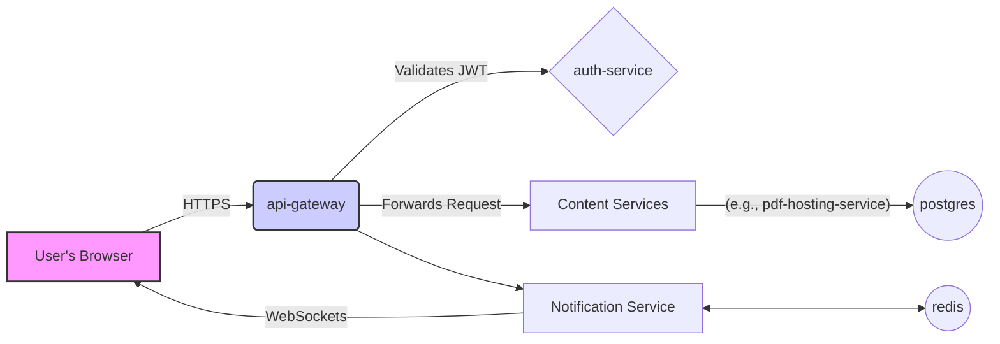

# Padh.ai System Architecture Overview

This document provides a high-level overview of the microservices architecture for the Padh.ai platform.

## Core Philosophy

The application is designed as a collection of independent, specialized services that communicate over a network. This approach, known as microservices, allows for:

- **Scalability:** Each service can be scaled independently based on demand.
- **Technology Flexibility:** Each service can be built with the best technology for its specific job (e.g., Node.js for I/O-heavy tasks, Go for high-performance processing).
- **Maintainability:** Services are smaller and easier to understand, develop, and deploy.

## Key Components

The main components of the system are defined in the `docker-compose.yaml` file.

| Service                   | Technology           | Role                                                                                              |
| ------------------------- | -------------------- | ------------------------------------------------------------------------------------------------- |
| **`frontend`**            | React (Vite)         | The client-side single-page application (SPA) that the user interacts with.                       |
| **`api-gateway`**         | Node.js (Express)    | The single entry point for all frontend requests. It handles routing, auth, and other cross-cutting concerns. |
| **`postgres`**            | PostgreSQL           | The central, persistent database for the entire application.                                      |
| **`auth-service`**        | Node.js              | Manages user identity, registration, login, and the issuance of access/refresh tokens.            |
| **`pdf-hosting-service`** | Go                   | Handles storage, retrieval, and metadata management for PDF documents and other user content.     |
| **`notification-service`**| Go                   | Manages real-time user notifications via WebSockets.                                              |
| **`redis`**               | Redis                | An in-memory data store, intended for use as a message broker and for caching to improve performance. |

## Request Flow Diagram

A typical request from a user flows through the system as follows:

### Explanation of the Flow:

1.  **Client to Gateway:** The `frontend` application sends all API requests to the `api-gateway`. For protected routes, it includes a JSON Web Token (JWT) in the `Authorization` header.
2.  **Gateway Responsibilities:** The `api-gateway` acts as the gatekeeper.
    -   It first validates the JWT (potentially by querying the `auth-service` or checking a shared secret).
    -   If the token is valid, it forwards the request to the appropriate downstream service based on the URL path (e.g., `/api/auth/*` goes to `auth-service`, `/api/pdfs/*` goes to `pdf-hosting-service`).
3.  **Service to Database:** The individual microservices (like `pdf-hosting-service`) contain the business logic. They connect to the `postgres` database to read or write data.
4.  **Real-time Notifications:**
    -   The `notification-service` maintains persistent WebSocket connections with active users.
    -   When another service wants to send a notification (e.g., `quiz-service` after a submission), it publishes an event to a `redis` channel.
    -   The `notification-service` listens to these channels and pushes the message to the relevant user(s) over their WebSocket connection.

This architecture provides a solid foundation for building a scalable, resilient, and feature-rich learning platform.
